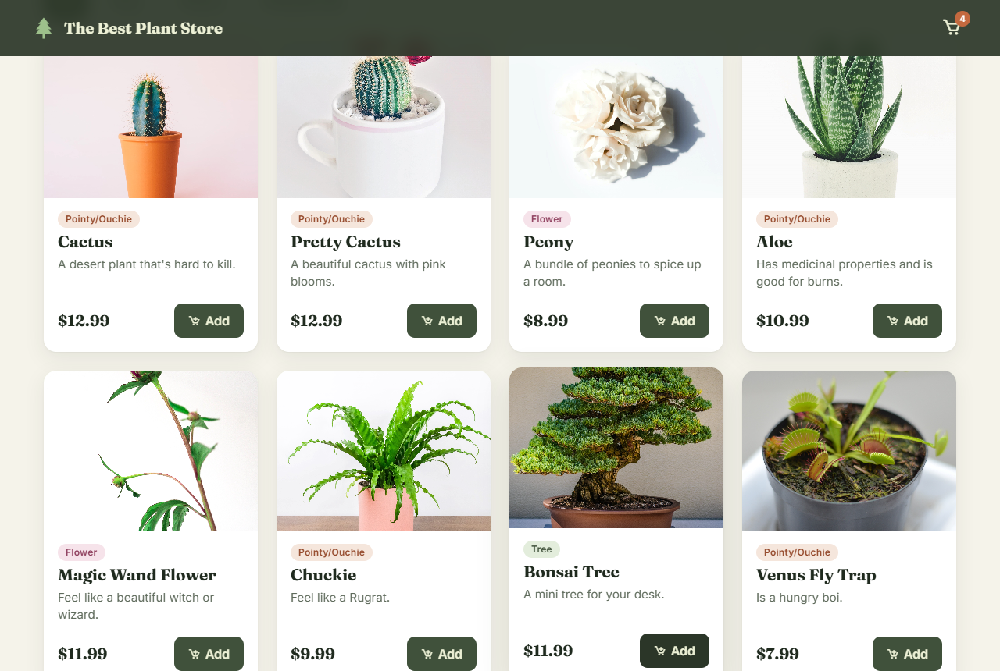
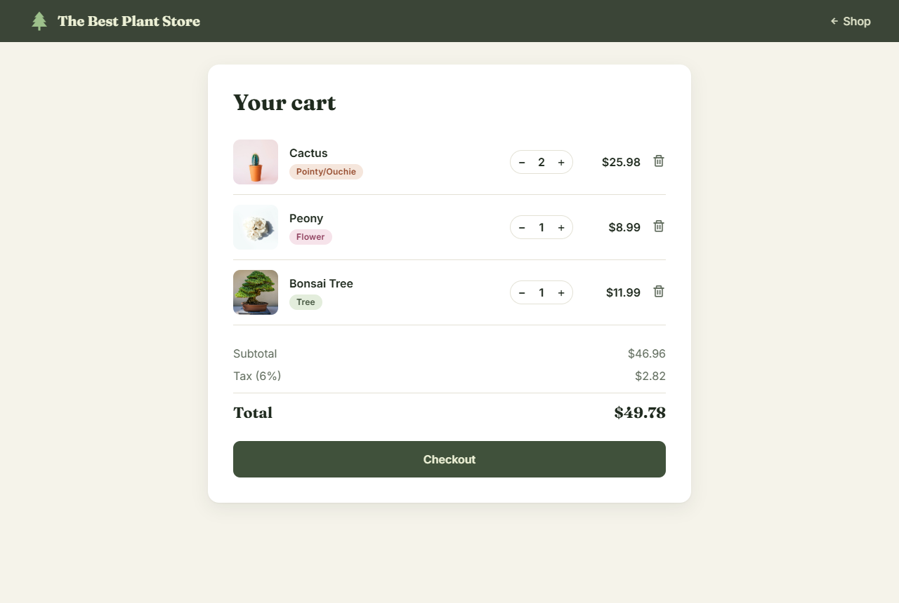
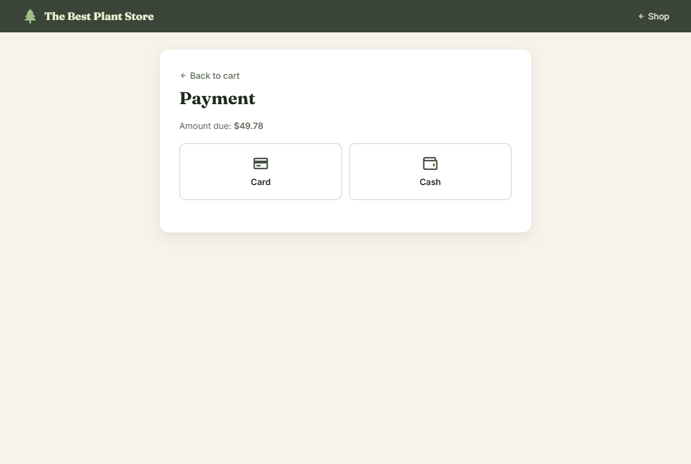
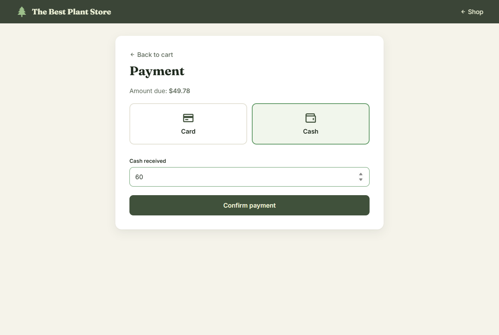
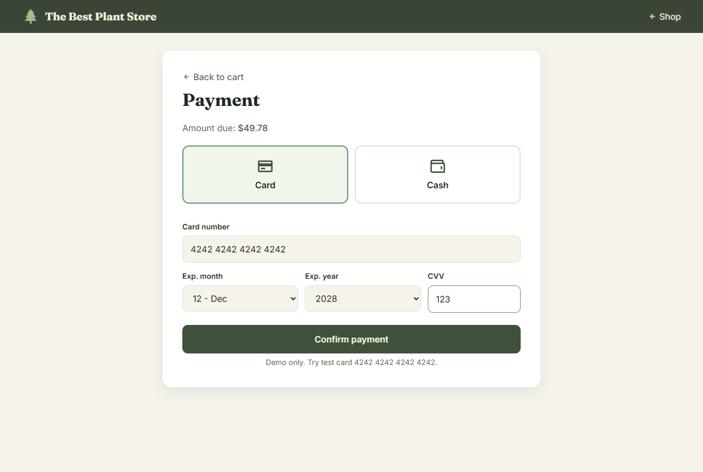
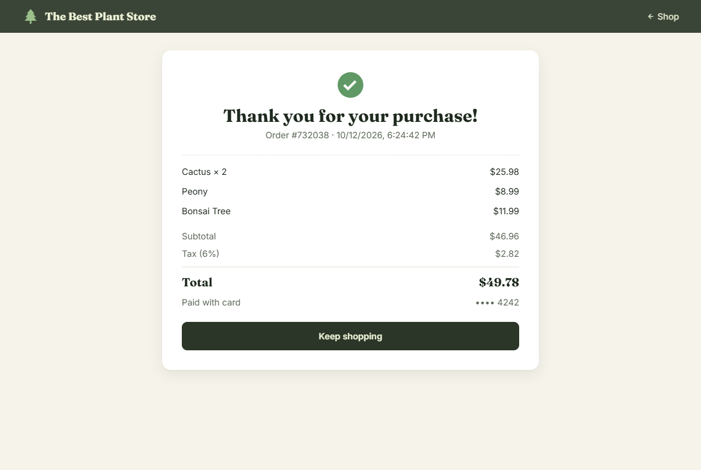

# The Best Plant Store :seedling: :potted_plant: :evergreen_tree:

A web page created by [Grif](https://github.com/grif-wakeman), [Sara](https://github.com/ssevans12), [Justin](https://github.com/jgreener6), and [Shelby](https://github.com/shelbysue).

The Best Plant Store is a point-of-sale web app for shopping some really cool plants: browse by category, build a cart, and check out with cash or card.

## Features

* 12 products with category, description, and price
* Category filters (Trees, Flowers, Pointy/Ouchie)
* Cart that persists between visits, with quantity controls and item removal
* Live cart badge and "added to cart" notifications
* Subtotal, 6% Michigan sales tax, and total, calculated in cents to avoid rounding errors
* Pay with cash (with change due) or card (with Luhn card-number and expiration-date validation)
* Itemized receipt with order number
* Responsive layout for phones, tablets, and desktops, with keyboard and screen-reader friendly controls

## Screenshots








## Running Locally

Requires [Node.js](https://nodejs.org/) 16 or newer. There are no dependencies to install.

```bash
npm start
```

Then open [http://localhost:3002](http://localhost:3002). To use a different port, set `PORT`, for example `PORT=8080 npm start`.

> Demo store only, no real payments are processed. Use test card `4242 4242 4242 4242` with any future expiration date and any 3-digit CVV.

## Project Structure

```
index.html      Shop page
cart.html       Cart, payment, and receipt
styles.css      Shared styles
js/store.js     Product catalog and cart helpers (localStorage)
js/shop.js      Product grid, filters, add to cart
js/cart.js      Cart editing, payment validation, receipt
server.js       Zero-dependency static server
```

## Technology Used

HTML, CSS, and vanilla JavaScript. Product photos from [Unsplash](https://unsplash.com).

## Challenges

* Unforeseen circumstances (schedules, power outages, etc.)
* Still learning the language
* Working our way through bugs
* Misunderstood the deadline
